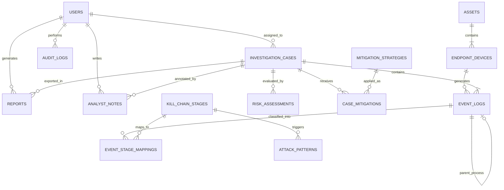

# Threat Trace — Database Design, ERD, & Normalization Specification

## 1. Entity-Relationship (ER) Diagram

---

## 2. Relational Schema Mapping & Constraints

The relational schema maps the ER diagram into **15 normalized tables (3NF/BCNF)**:

1. **`users`** (`user_id` [PK], `username` [UNIQUE], `password_hash`, `full_name`, `email` [UNIQUE], `role`, `created_at`)
   - *Functional Dependencies:* `user_id -> username, password_hash, full_name, email, role, created_at`
2. **`assets`** (`asset_id` [PK], `asset_name`, `asset_type`, `criticality_score`, `owner_team`, `ip_subnet`, `created_at`)
   - *Functional Dependencies:* `asset_id -> asset_name, asset_type, criticality_score, owner_team, ip_subnet`
3. **`endpoint_devices`** (`device_id` [PK], `asset_id` [FK -> `assets.asset_id`], `hostname` [UNIQUE], `ip_address`, `os_version`, `status`, `created_at`)
   - *Functional Dependencies:* `device_id -> asset_id, hostname, ip_address, os_version, status`; `hostname -> device_id`
4. **`investigation_cases`** (`case_id` [PK], `case_number` [UNIQUE], `title`, `description`, `status`, `severity_level`, `risk_score`, `assigned_analyst_id` [FK -> `users.user_id`], `created_at`, `updated_at`)
   - *Functional Dependencies:* `case_id -> case_number, title, description, status, severity_level, risk_score, assigned_analyst_id`
5. **`event_logs`** (`event_id` [PK], `event_code` [UNIQUE], `case_id` [FK -> `investigation_cases.case_id`], `device_id` [FK -> `endpoint_devices.device_id`], `event_time`, `event_type`, `severity`, `user_name`, `process_name`, `parent_event_id` [FK -> `event_logs.event_id`], `target`, `source`, `description`, `raw_payload`, `created_at`)
   - *Functional Dependencies:* `event_id -> event_code, case_id, device_id, event_time, event_type, severity, user_name, process_name, parent_event_id, target, source, description, raw_payload`
6. **`kill_chain_stages`** (`stage_id` [PK], `stage_name` [UNIQUE], `stage_order` [UNIQUE], `description`)
7. **`event_stage_mappings`** (`mapping_id` [PK], `event_id` [FK -> `event_logs.event_id`], `stage_id` [FK -> `kill_chain_stages.stage_id`], `mapping_rule`, `explanation`, `mapped_at`)
8. **`attack_patterns`** (`pattern_id` [PK], `pattern_code` [UNIQUE], `pattern_name`, `rule_expression`, `stage_id` [FK -> `kill_chain_stages.stage_id`], `severity_weight`)
9. **`threat_actor_profiles`** (`profile_id` [PK], `actor_codename` [UNIQUE], `tactics_summary`, `typical_kill_chain_signature`, `risk_indicator_score`)
10. **`risk_assessments`** (`assessment_id` [PK], `case_id` [FK -> `investigation_cases.case_id`], `total_score`, `assessment_time`, `algorithm_version`, `factor_breakdown_json`)
11. **`mitigation_strategies`** (`mitigation_id` [PK], `mitigation_code` [UNIQUE], `action_name`, `effort_level`, `business_impact`, `category`, `description`)
12. **`case_mitigations`** (`case_mitigation_id` [PK], `case_id` [FK -> `investigation_cases.case_id`], `mitigation_id` [FK -> `mitigation_strategies.mitigation_id`], `recommendation_score`, `status`, `analyst_rationale`, `updated_at`)
13. **`reports`** (`report_id` [PK], `case_id` [FK -> `investigation_cases.case_id`], `generated_by` [FK -> `users.user_id`], `report_format`, `file_path`, `generated_at`)
14. **`analyst_notes`** (`note_id` [PK], `case_id` [FK -> `investigation_cases.case_id`], `analyst_id` [FK -> `users.user_id`], `note_text`, `is_false_positive_flag`, `created_at`)
15. **`audit_logs`** (`audit_id` [PK], `user_id` [FK -> `users.user_id`], `action_type`, `entity_affected`, `timestamp`, `details`)

---

## 3. Relational Algebra Formulations

### 3.1 Selection ($\sigma$) & Projection ($\pi$)
Extract process events with `CRITICAL` severity:
$$\pi_{\text{event\_code}, \text{event\_time}, \text{process\_name}} (\sigma_{\text{event\_type} = \text{'PROCESS'} \land \text{severity} = \text{'CRITICAL'}} (\text{event\_logs}))$$

### 3.2 Natural Join ($\bowtie$)
Join event logs with endpoint devices and parent assets:
$$\text{event\_logs} \bowtie_{\text{event\_logs.device\_id} = \text{endpoint\_devices.device\_id}} \text{endpoint\_devices} \bowtie_{\text{endpoint\_devices.asset\_id} = \text{assets.asset\_id}} \text{assets}$$

### 3.3 Set Union ($\cup$)
Union high-severity events with unassigned cases:
$$\pi_{\text{event\_code}, \text{description}} (\sigma_{\text{severity} \in \{\text{'HIGH'}, \text{'CRITICAL'}\}} (\text{event\_logs})) \cup \pi_{\text{case\_number}, \text{title}} (\sigma_{\text{assigned\_analyst\_id IS NULL}} (\text{investigation\_cases}))$$

---

## 4. Normalization Reasoning (1NF to BCNF)

### 4.1 First Normal Form (1NF)
- **Requirement:** Atomic values, no repeating groups.
- **Enforcement:** Raw payloads and JSON breakdown fields are scalar strings. Lists of mapped stages or mitigations are broken into dedicated junction tables (`event_stage_mappings`, `case_mitigations`).

### 4.2 Second Normal Form (2NF)
- **Requirement:** 1NF + no partial key dependencies.
- **Enforcement:** Every table has a single surrogate primary key (`event_id`, `case_id`, `device_id`). All non-key attributes depend on the entire primary key.

### 4.3 Third Normal Form (3NF)
- **Requirement:** 2NF + no transitive dependencies ($X \rightarrow Y, Y \rightarrow Z$).
- **Decomposition Example:** Instead of storing `hostname`, `ip_address`, `asset_name`, and `owner_team` inside `event_logs`, device details are separated into `endpoint_devices`, which references `assets`. This eliminates update anomalies if an asset's owner team changes.

### 4.4 Boyce-Codd Normal Form (BCNF)
- **Requirement:** For every functional dependency $X \rightarrow Y$, $X$ must be a superkey.
- **Enforcement:** Candidate keys like `username`, `case_number`, `hostname`, `event_code`, and `mitigation_code` are defined with `UNIQUE` constraints.

---

## 5. Multivalued Dependencies & 4NF Teaching Example

### 4NF Principle
Fourth Normal Form (4NF) requires that a table in BCNF contains no non-trivial **multivalued dependencies (MVD)** ($A \twoheadrightarrow B$).

### Teaching Example (Independent Multivalued Facts)
Suppose an unnormalized schema attempted to store an Analyst's **Assigned Cases** and **Security Certifications** in a single table:

| analyst_id | assigned_case | certification |
| :--- | :--- | :--- |
| 1 | CASE-001 | CISSP |
| 1 | CASE-001 | CEH |
| 1 | CASE-002 | CISSP |
| 1 | CASE-002 | CEH |

Here, `analyst_id` $\twoheadrightarrow$ `assigned_case` and `analyst_id` $\twoheadrightarrow$ `certification` are two independent multivalued facts. Storing them in one table creates insertion and deletion redundancy anomalies.

### 4NF Decomposition
To achieve 4NF, the table is decomposed into two independent binary tables:
1. `analyst_cases` (`analyst_id`, `case_id`)
2. `analyst_certifications` (`analyst_id`, `certification_name`)

This eliminates MVD redundancy. In Threat Trace, table relationships avoid independent multivalued facts by design.
